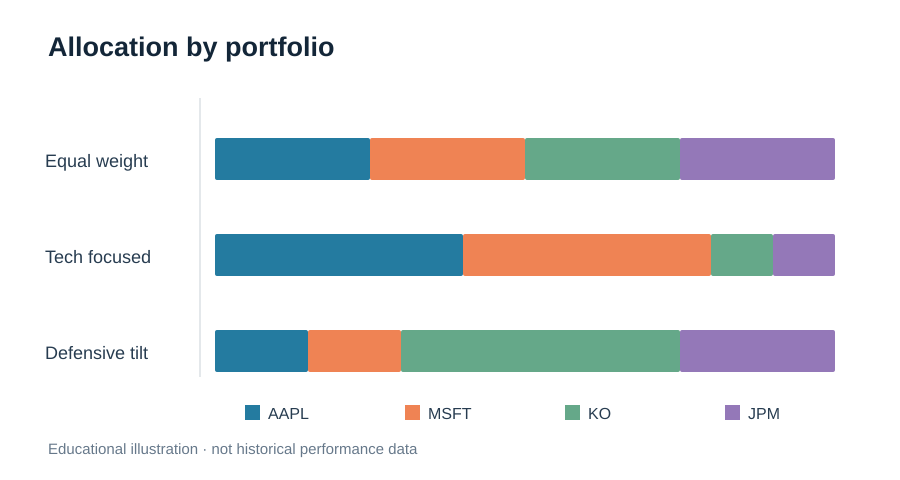
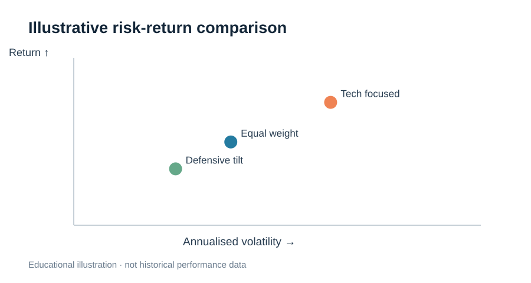
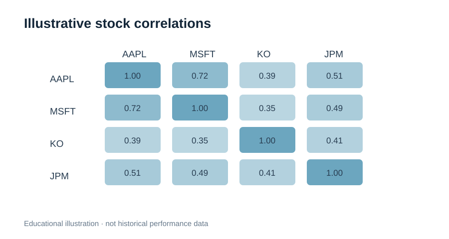

# Portfolio Risk and Return Calculator

A beginner-friendly Python project comparing **three allocations across four stocks**.

## Research question

How does changing a portfolio's stock weights affect its historical return, volatility and diversification?

## Stocks and allocations

| Portfolio | Apple (AAPL) | Microsoft (MSFT) | Coca-Cola (KO) | JPMorgan (JPM) |
| --- | ---: | ---: | ---: | ---: |
| Equal weight | 25% | 25% | 25% | 25% |
| Tech focused | 40% | 40% | 10% | 10% |
| Defensive tilt | 15% | 15% | 45% | 25% |

These stocks are examples, not investment recommendations.

## What the program does

1. Downloads three years of adjusted daily closing prices using `yfinance`.
2. Calculates daily percentage returns and the covariance matrix.
3. Calculates **annualised arithmetic historical mean return**, **annualised volatility**, and **diversification benefit** for each allocation.
4. Prints a comparison table, saves a CSV and generates a bar chart.

## Getting started

Install Python 3.10+ and run:

```bash
python -m pip install -r requirements.txt
python portfolio_calculator.py
```

An internet connection is required for the price download. Outputs are saved in `output/portfolio_comparison.csv` and `output/portfolio_comparison.png`.

## The maths, in plain English

- **Daily stock return** = (today's adjusted close / yesterday's adjusted close) − 1.
- **Annualised historical return** = weighted mean daily stock return × 252 trading days. This is an arithmetic estimate, **not** a prediction or compound annual growth rate.
- **Annualised volatility** = standard deviation of daily portfolio returns × √252.
- **Diversification benefit** = weighted average annualised individual-stock volatility − annualised portfolio volatility.
- **Covariance** captures the degree to which stock returns move together. Lower co-movement can reduce combined portfolio volatility.

The metrics treat portfolio weights as constant (as with daily rebalancing), and do not account for trading costs or taxes.

## Questions to try

1. Which portfolio had the highest historical return? Which had the lowest volatility?
2. Why can the portfolio have lower volatility than the weighted average of its stocks?
3. Change the weights (ensuring they total 100%). What changes?
4. Would you expect the same ranking over a different three-year window?

## Interview explanation

> I used Python to compare how four-stock allocations affect historical risk and return. I calculated daily returns, used covariance to estimate the portfolio's volatility, and visualised the results. I learned that diversification depends on how stocks move together, not just how many stocks are held.

## Limitations

This project is educational, not financial advice. Historical estimates change across time periods; future returns and correlations may differ. Portfolio volatility does not describe all forms of financial risk.

## Visual overview

The allocation chart uses the exact weights in the script. **The risk-return and correlation visuals are illustrative examples, not calculated from current market data.** Run the Python project to obtain actual historical metrics.

### Portfolio weights



### Risk and return



### Stock correlations


